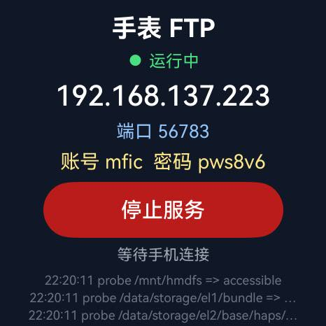

# Huawei Watch Files

An FTP server that runs on the watch, so a phone can copy files to and from it over Wi-Fi. Watch side only; the phone side is whatever FTP client you already have.



## Status

- Device: HUAWEI WATCH 5 (`RTS-AL00`), OpenHarmony 6.1.0.125, API 23
- Package: `io.github.leggerezza.files`
- SDK: target 26.0.0, compatible 6.1.0(23)
- Builds, signs and installs on the watch
- Tested end to end on the device

```
wrong password       rejected
LIST /               ok
STOR 512 KB          ok
RETR 512 KB          SHA-256 matches
MKD RNFR RNTO DELE   ok
```

## The FTP root is the app sandbox

Wearables give third-party apps no public directory. Checked from inside the app (`hilog` tag `WatchFtp`):

| Path | Result |
| --- | --- |
| `/storage/media` | missing |
| `/storage/media/100/local/files` | missing |
| `/storage/media/100/local/files/Docs` | missing |
| `/storage/media/100/local/files/Download` | missing |
| `/mnt/share` | missing |
| `/mnt/hmdfs` | accessible, distributed FS mount, not a user directory |
| `/data/storage/el1/bundle` | accessible, own read-only install directory |
| `/data/storage/el2/base/haps/entry/files` | accessible, used as the FTP root |

The root is `context.filesDir`. Files are removed together with the app. They cannot be written to the watch's gallery or Downloads, because there is nothing to write to; that part has to happen on the phone.

Background: [app sandbox](https://developer.huawei.com/consumer/cn/doc/doccenter-capabilities/app-sandbox-directory), [getUserDownloadDir is PC/2in1 only](https://developer.huawei.com/consumer/cn/doc/doccenter-references/api/js-apis-file-environment).

## Credentials

Generated on every start and shown on the watch face.

- user: 4 lowercase letters, alphabet skips `i l o`
- password: 6 characters, `a-z` without `i l o` plus `2-9` without `0 1`
- control port is random too, 30000-59999, new one on every start
- 3 wrong `PASS` on one connection: `421` and the connection closes
- 12 wrong `PASS` in total: the server stops
- `USER` always gets `331`, so it does not confirm the account name
- the password is never logged
- before login only `USER PASS QUIT FEAT SYST NOOP` are answered

Key space is 24^4 * 31^6, about 2.9e14. That keeps port scanners and people who stumble onto the URL out. It does not stop packet capture, because FTP sends credentials in clear text. If that is the threat you care about, FTP is the wrong protocol.

Why not FTPS, HTTPS or WebDAV: [docs/protocol-assessment.md](docs/protocol-assessment.md).

## Commands

`USER PASS SYST FEAT OPTS PWD CWD CDUP TYPE MODE STRU PASV EPSV LIST NLST MLSD MLST RETR STOR APPE REST SIZE MDTM DELE MKD RMD RNFR RNTO NOOP ABOR STAT ALLO QUIT`

- passive mode only: `PASV` (227) and `EPSV` (229); `PORT` and `EPRT` get `502`
- client paths are normalised and `..` is clamped at the virtual root
- commands on one connection run in order, so a transfer cannot interleave with the next command

## Build, install, test

```powershell
powershell -ExecutionPolicy Bypass -File .\Build-Hap.ps1
powershell -ExecutionPolicy Bypass -File .\Deploy-Hap.ps1 -Device 192.168.137.223:42295
powershell -ExecutionPolicy Bypass -File .\Test-Ftp.ps1 -WatchIp 192.168.137.223 -Port 56783 -User mfic -Pass pws8v6
```

Port and credentials change on every start. To read them without looking at the watch:

```powershell
hdc -t <serial> shell "hilog -x | grep WatchFtp | grep listening | tail -1"
```

Signing uses DevEco automatic signing. `build-profile.json5` holds the resulting config with encrypted, machine-bound passwords; on another machine, turn automatic signing on again.

## Layout

```
entry/src/main/ets/services/FtpServer.ets   protocol, sockets, passive data channel
entry/src/main/ets/services/FsStore.ets     sandbox file access, path clamping
entry/src/main/ets/services/NetInfo.ets     picks the Wi-Fi IPv4 for display
entry/src/main/ets/pages/Index.ets          466x466 UI
Build-Hap.ps1 Deploy-Hap.ps1 Test-Ftp.ps1
tools/Start-Hotspot.ps1                     revives the Windows mobile hotspot
```

## Not done

- No background task. The server lives while the page is in front, so the screen going off can kill a long transfer. Needs `backgroundTaskManager` with `DATA_TRANSFER` and `ohos.permission.KEEP_BACKGROUND_RUNNING`.
- No phone app. The phone side is a third-party FTP client.
- No HTTP portal or WebDAV yet; see the assessment doc.
- UI strings are Chinese.

## Windows note

Windows 11 turns the mobile hotspot off when no device has been connected for a while. The watch then sleeps, cannot rejoin, and hdc stays offline until the hotspot is back. `tools/Start-Hotspot.ps1` starts it through the WinRT tethering API.
